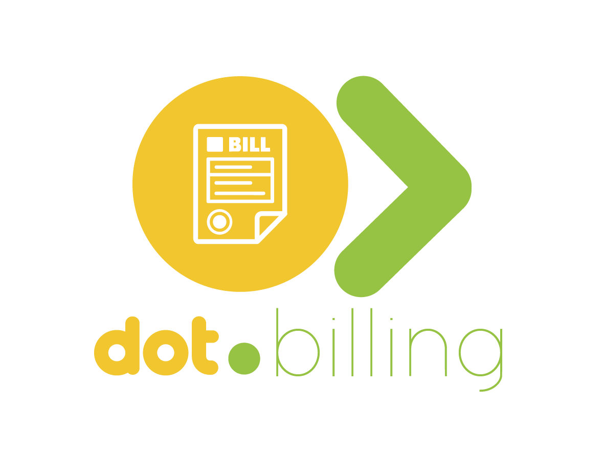

<div align="center">



<br /><br />

**Manage plans, track invoices, and analyse spend across the Dot ecosystem.**

<br />

   

<br /><br />

**Part of the [InfoDot Ecosystem](https://github.com/sakhileb/InfoDot)** &nbsp;·&nbsp; `billing.infodot.app`

</div>

---

## What is Dot.Billing?

Dot.Billing is the subscription and billing management platform in the InfoDot ecosystem. Teams track their active plans, receive and pay invoices, monitor cross-platform usage, and get AI-powered spend optimisation recommendations — all in one billing intelligence hub.

## Core Features

- Subscriptions: plans, monthly/annual billing, trials, plan changes at renewal, cancel at period end and resume
- A plan catalogue that platform operators manage (create, edit, archive; never delete)
- An invoice engine: per-team sequential invoice numbers, snapshot line items, configurable tax and terms, a print-friendly invoice view
- Money in integer minor units (cents); totals are always per currency, never summed across currencies
- Invoice dashboard and search, and a per-invoice detail page
- Pay an invoice online through Paystack (**test mode only**), with a signed webhook, server-side verification and an operator page for payment events that need a person
- Usage records per platform (`billing_usage_records`)
- Budget alerts (`billing_alerts`) and a human-gated dunning queue for operators
- In-app notification bell (Laravel's `database` notification channel) for billing events
- Dark / light mode toggle (Tailwind class-based strategy, persisted per browser)
- AI spend analysis (Claude), shown only when the call really worked
- Ecosystem SSO from InfoDot hub

> **Paystack is integrated in TEST MODE ONLY.** An owner or admin can pay an open invoice through Paystack's hosted
> checkout; a live (`sk_live_`) key is refused unless `PAYSTACK_ALLOW_LIVE=true` is ALSO set. No card number ever
> reaches this app. Everything else is recorded as a manual payment. The `stripe_*` columns are unused references.

## How billing works

**Money.** Every amount is stored as integer minor units in `*_cents` columns (`App\Support\Money`).
The original `decimal(10,2)` columns remain as a mirror the models keep in step, so a rollback or an old reader
still sees correct numbers; new code reads and writes cents. Every amount carries its own currency and the
dashboard lists totals per currency. All supported currencies are assumed to have two minor-unit digits.

**Subscriptions** (`App\Services\Billing\SubscriptionService`). A team has at most one live subscription
(`active`, `trialing` or `past_due`): the service checks, and a partial unique index enforces it on SQLite and
PostgreSQL (MySQL has no partial indexes; there the service check is the only guard). Only team owners and
Jetstream admins may subscribe, change plan, cancel or resume (the `manage-billing` gate). A plan change on a
running subscription takes effect at the next renewal, so there is no proration. A team gets one trial.

**The clock** (both scheduled daily, both idempotent, both safe to re-run):

| Command | Does |
|---|---|
| `billing:advance-subscriptions` (01:00) | ends expired trials, rolls ended periods forward (applying a queued plan change) and invoices the new period, ends subscriptions scheduled to cancel, keeps `past_due` accurate |
| `billing:generate-invoices` (01:30) | raises the invoice for any live paid subscription whose current period has none (catch-up and standalone use) |

Billing is in advance: one invoice per period, raised when the period starts. Free plans and trials are never
invoiced. Nothing is charged automatically, and nothing is ever cancelled for non-payment automatically:
`past_due` only records that an open invoice is overdue.

**Invoices.** Numbers are per team and per year (`INV-{YYYY}-{seq}`, configurable), allocated under a row lock
inside the invoice transaction. Status runs `draft` to `open` to `paid` or `void` (`uncollectible` exists on
legacy rows). Due date is issue date plus the configured terms. Line items are snapshots. See `config/billing.php`
for number format, terms, tax rate (a percentage, default 0), auto-finalize, issuer details for the print view,
and the free-tier limits.

**Roles.** Owner and `admin` manage billing. `editor` and the read-only `viewer` role can read invoices and the
subscription state. A draft invoice is visible only to managers.

**Recording payments** (`App\Services\Billing\RecordPayment`). The one entry for money arriving. It applies a
payment to an invoice inside a transaction with the invoice locked: partial payments are allowed, an overpayment
or a wrong currency is rejected, only an `open` invoice can be paid, and the invoice becomes `paid` when the
balance reaches zero. Every fact is stored in `payment_events` (provider and external id nullable;
`unique(provider, external_id)` so a replayed provider event is a no-op, and the same id with different details
is a `payment_conflict`). The stored payload has secrets scrubbed. Owners and admins can use "Record a manual
payment" on an open invoice; it is logged with their name. Only payments are applied: refunds are not modelled (a Paystack `refund.processed` is recorded for an operator, never applied).

### Paystack

Paystack is the one payment provider, behind the same seam as manual payments. **Test mode only**: build, verify and
demo with `sk_test_...` keys. Nothing in this repo has been run against Paystack itself (every test uses `Http::fake`),
so do one end-to-end run with test cards before relying on it.

**Setup (test mode)**

1. In the Paystack dashboard switch to **Test mode** and copy the test secret key (`sk_test_...`) and public key (`pk_test_...`).
2. Put them in `.env` (`PAYSTACK_SECRET_KEY`, `PAYSTACK_PUBLIC_KEY`), then `php artisan config:clear` if config is cached.
3. In the dashboard, Settings, API Keys & Webhooks, set the **Test Webhook URL** to `https://<your-host>/webhooks/paystack`.
   Billing sends the per-payment callback URL itself (`/billing/paystack/callback/{attempt}`), so the dashboard's
   callback URL is not used; it needs no setting.
4. Open an open invoice as an owner or admin: **Pay now** appears with a `TEST MODE` badge. Use Paystack's published
   test cards on its checkout page.

**The TEST MODE guard.** A key starting `sk_test_` is test mode and shows a `TEST MODE` badge (top bar, invoice page).
A key starting `sk_live_` is refused, never sent, never used to verify a webhook, and logged without the key, unless
`PAYSTACK_ALLOW_LIVE=true` is ALSO set. A key that is neither is refused as unrecognised, and a base URL that is not
https is refused. With no key, "Pay now" is hidden and the invoice page says online payment is not set up.

**Flows**

- *Pay now* (`POST /invoices/{invoice}/pay`, owner or admin of the invoice's company, open invoice with a balance only).
  Inside one transaction with the invoice row locked, a `payment_attempts` row is created for the balance at that moment
  (our unique reference, status `initiated`) and Paystack's `/transaction/initialize` is called (amount in cents, ZAR,
  metadata with the invoice and company ids). The payer is redirected to Paystack's checkout. A second click reopens the
  same attempt (one live attempt per invoice; it expires after `PAYSTACK_ATTEMPT_TTL_MINUTES`, or sooner if the balance
  changed). If Paystack is down, the transaction rolls back: no attempt, no state change, a friendly message.
- *Coming back* (`GET /billing/paystack/callback/{attempt}`, signed-in manager). Nothing in the query string is read.
  Billing calls `/transaction/verify/{reference}` with the reference it stored and applies the payment only if Paystack
  says `success` AND the amount, currency and reference match the attempt.
- *Webhook* (`POST /webhooks/paystack`, no session or CSRF). `x-paystack-signature` (HMAC-SHA512 of the raw body with the
  secret key) is checked with `hash_equals` over the exact bytes before the body is parsed. Bad or missing: bare `401`.
  Not JSON: `400`. `charge.success` is matched to our attempt and settled; `refund.processed` is recorded for an operator;
  other events are acknowledged and ignored. Every business condition answers `200` so Paystack does not retry forever.
- *Exactly once.* The callback and the webhook share `PaystackSettlement`: the attempt row is locked and the payment goes
  through `RecordPayment` with `provider = paystack` and the Paystack transaction id, so `unique(provider, external_id)`
  makes callback-then-webhook, webhook-then-callback, webhook twice and truly concurrent deliveries apply once (also
  checked with eight simultaneous deliveries against PostgreSQL 16).
- *Held for operators.* An unknown reference, an amount, currency or reference mismatch, a body that is not a success, an
  overpayment (the balance shrank while the payer was on Paystack) and an invoice that was settled meanwhile are written
  to `payment_events` with `status = unmatched` or `needs_review` and a `reason`, apply nothing, and show on
  `/operator/payment-events` (read-only; operators resolve them with Paystack). Paying in full closes the invoice and
  resolves its open dunning case, as for any payment; existing `invoice.overdue` reminders are untouched.
- *Refunds.* The ledger has no refund concept and reopening a paid invoice is a business decision, so a
  `refund.processed` event is stored as `needs_review` (`refund_not_modelled`) with an audit row, and the invoice is left alone.

**Not built:** card-on-file and automatic charging, subscriptions as Paystack plans, payouts and transfers, split
payments, refunds that reopen a balance, and a manual "link this event to an invoice" action.

**Verified against Paystack's documentation vs assumed**

- Confirmed from Paystack's docs: base URL, bearer auth, initialize body (email, amount in the currency's subunit,
  currency, reference with only `-` `.` `=` and alphanumerics, callback_url, metadata as stringified JSON) and the
  `authorization_url` / `access_code` / `reference` response; verify returns `data.id`, `status`, `amount`, `currency`,
  `reference`; `x-paystack-signature` is a HMAC-SHA512 of the payload with the secret key; `charge.success` carries the
  amount in subunits; webhooks should be acknowledged with `200`; refund events are `refund.pending`, `refund.processing`,
  `refund.processed`, `refund.failed`.
- Not confirmed (the docs pages could not be fetched directly; taken from search excerpts and third-party guides):
  the exact `refund.processed` payload (the code accepts `transaction_reference` and `transaction.reference`), the full
  list of verify statuses (only `success` is ever treated as paid; `failed`, `abandoned` and anything else are not),
  that `charge.failed` does not exist (it is simply ignored), how long a checkout stays valid, and whether the
  signature may arrive upper-case (the code accepts either).

### Entitlements API

`GET /api/entitlements/{company_uuid}` tells another Dot app what a company is on. `company_uuid` is InfoDot's
company id, matched to `teams.infodot_team_uuid`. Server to server only, signed like InfoDot's other calls:

| Header | Value |
|---|---|
| `X-InfoDot-Platform` | the calling platform's key, e.g. `files` |
| `X-InfoDot-Timestamp` | unix time, accepted within 5 minutes either way |
| `X-InfoDot-Signature` | `sha256=` + HMAC-SHA256 hex of `"{timestamp}.{raw body}"` (the body of a GET is empty) |

Each platform has its own secret in `BILLING_ENTITLEMENT_SECRET_<KEY>` (a blank secret means that platform cannot
call). Bad or stale signatures, unknown platforms and blank secrets all return the same `401`; an unknown company
is a generic `404`, and only after authentication. The response carries `status` (`active`, `trialing`,
`past_due`, `canceled`, `none`), the plan, `seat_limit` and `storage_gb` (`null` = unlimited), `features`,
`period_end` and `cancel_at_period_end`, with an `ETag`. `seat_limit` is the plan's seats plus the extra seats the
company has paid for, reported separately as `extra_seats` (see `docs/seat-purchasing.md`). A company with no live subscription gets the free-tier
limits from `config/billing.php` (placeholders: set `BILLING_FREE_SEAT_LIMIT` and `BILLING_FREE_STORAGE_GB`).
`past_due` keeps the plan's limits; whether to restrict is the consuming app's decision. The signature does not
cover the URL (the scheme's known limit). Operators can check any company at `/operator/entitlements`.

### Dunning, reminders and safety

`billing:scan-alerts` (every 15 minutes) opens a **dunning case** for an invoice that is open and past its due
date, and for a failed payment, for a platform operator to review at `/operator/dunning-cases`. It never suspends
or cancels anything. The operator can:

- **Grant grace**: the case moves to `grace` with an end date and the invoice stops counting as overdue until then.
  The invoice's real due date is not rewritten. The scanner reopens the case only after the grace ends and the
  invoice is still unpaid.
- **Cancel the subscription**: ends the one subscription the case's invoice was raised for. If that cannot be
  determined (a legacy invoice with no link and no single live subscription) nothing is cancelled and the
  operator is told.
- **Dismiss**: closes the case, changes nothing else.

Each case is unique per overdue invoice and per failed payment (a partial unique index on SQLite and PostgreSQL,
the scanner's check elsewhere). Paying an invoice in full resolves its open case.

**Overdue reminders** go to Dot.Notify's ingest API (`POST /api/ingest/events`, event `invoice.overdue`, to the
team owner) through `App\Services\Notify\NotifyClient`: queued (`App\Jobs\SendNotifyEvent`, so it needs a queue
worker, `php artisan queue:work`), 5 second timeout, retried with backoff while Notify is down, never throws into
the caller, and disabled when `NOTIFY_INGEST_URL` or `NOTIFY_INGEST_SECRET` is blank. The request is signed with
HMAC-SHA256 over `"{timestamp}.{raw body}"`; the idempotency key is event + invoice id + date. The team must be
linked to InfoDot (`teams.infodot_team_uuid`) or there is nobody to address and the reminder is skipped.

**Metrics for Dot.Analytics.** Once a day (03:00 UTC, `billing:publish-metrics`) this app queues one signed snapshot
per company to Dot.Analytics' server-to-server ingest (`POST /api/ingest/snapshots`) through
`App\Services\Analytics\AnalyticsClient` and `App\Jobs\SendAnalyticsSnapshot`. A company is a non-personal team
linked to InfoDot (`teams.infodot_team_uuid`); personal and unlinked teams are skipped.

What is sent, and nothing else (Dot.Analytics' `billing` catalogue; counts and whole-cent sums only, never a name,
email, invoice number or row):

| Key | Meaning |
|---|---|
| `mrr_cents` | monthly recurring revenue: active and past_due subscriptions at their plan price, annual plans divided by 12 and rounded half up once. Trials are not revenue and are not counted |
| `open_invoices` | invoices with status `open` |
| `overdue_invoices` | open invoices past their due date and outside a grace period (the app's own overdue rule) |
| `overdue_cents` | the balance still owed on those invoices |
| `currency` | ISO 4217 code of the two `*_cents` keys |

A snapshot carries one currency. A company whose money is in more than one currency has `mrr_cents`,
`overdue_cents` and `currency` left out (with a logged warning) rather than summed or guessed; a company with no
subscriptions and no invoices has no currency to report in, so they are left out too. The snapshot is stamped
with `taken_at` = the start of the UTC day, so a retry or a second run the same day is the same snapshot upstream
(Dot.Analytics keeps the first one it received for a day).

Nothing is sent until `ANALYTICS_INGEST_URL` (the full URL ending `/api/ingest/snapshots`) **and**
`ANALYTICS_INGEST_SECRET` are set; the secret is the same value as `ANALYTICS_INGEST_SECRET_BILLING` in
Dot.Analytics' `.env`. Requests are HMAC-SHA256 signed over `"{timestamp}.{raw body}"` at send time, time out after
5 seconds, are retried up to 3 times with backoff, never throw into the app, and stop for 5 minutes (circuit
breaker) after 5 failures in a row, so an Analytics outage or a wrong URL cannot affect Billing. This needs the
scheduler (`* * * * * php artisan schedule:run`) and a queue worker (`php artisan queue:work`). Try it safely with
`php artisan billing:publish-metrics --dry-run` (prints the payloads, sends nothing) and `--company=<uuid>`.

**Safety.** Financial foreign keys are `RESTRICT` on PostgreSQL and MySQL, so a team's subscriptions, invoices,
payments and dunning history cannot be destroyed by deleting the team; the app refuses first with a message. This
means a team (and an account that owns one) with billing history cannot be deleted: retention over erasure,
pending an owner decision. SQLite (development and tests) keeps the old constraints and relies on the app-level
guard. Indexes exist for the statuses, due dates and `(team_id, status)` pairs the clock and scanner query.

**AI spend analysis** returns what the model actually said about this team's usage totals, labelled as AI-written.
With no `ANTHROPIC_API_KEY`, a failed call or an unusable answer it shows "AI analysis unavailable" and stores
nothing; there is no fallback copy. Viewers cannot trigger it.

### Configuration

| Variable | Meaning |
|---|---|
| `BILLING_INVOICE_NUMBER_FORMAT`, `BILLING_INVOICE_NUMBER_PAD` | invoice numbers, default `INV-{YYYY}-{seq}`, padded to 4 |
| `BILLING_PAYMENT_TERMS_DAYS` | days from issue to due date, default 14 |
| `BILLING_AUTO_FINALIZE_INVOICES` | `false` leaves generated invoices as drafts for a manager to finalize |
| `BILLING_TAX_RATE` | percentage applied to the subtotal, default `0` |
| `BILLING_ISSUER_NAME`, `_ADDRESS` (`\|`-separated lines), `_TAX_NUMBER`, `_EMAIL` | printed on the invoice; blank means not printed |
| `BILLING_FREE_SEAT_LIMIT`, `BILLING_FREE_STORAGE_GB` | entitlements for a company with no live subscription (placeholders) |
| `BILLING_ENTITLEMENT_SECRET_<KEY>` | per-platform secret for the entitlements API; blank = that platform cannot call |
| `NOTIFY_INGEST_URL`, `NOTIFY_INGEST_SECRET` | Dot.Notify ingest endpoint and this app's signing secret; blank disables reminders |
| `PAYSTACK_SECRET_KEY` | Paystack secret key, `sk_test_...`; blank switches online payment off. A `sk_live_` key is refused unless `PAYSTACK_ALLOW_LIVE=true` |
| `PAYSTACK_PUBLIC_KEY` | `pk_test_...`; kept for completeness, the redirect flow does not need it in the browser |
| `PAYSTACK_BASE_URL` | default `https://api.paystack.co`; must be https |
| `PAYSTACK_ALLOW_LIVE` | default `false`; the second switch a live key needs |
| `PAYSTACK_ATTEMPT_TTL_MINUTES` | default `30`; how long "Pay now" reopens the same checkout |
| `ANALYTICS_INGEST_URL`, `ANALYTICS_INGEST_SECRET`, `ANALYTICS_PLATFORM_KEY` | Dot.Analytics snapshot endpoint, shared signing secret, platform key (default `billing`); blank URL or secret disables publishing |

## Responsive shell

The app shell in `resources/views/layouts/app.blade.php` works on phones. At 860px and wider the 260px sidebar and top bar are unchanged. Below 860px the sidebar becomes an off-canvas drawer opened by the labelled **Menu** button in the top bar (`aria-controls="app-sidebar"`, `aria-expanded` kept in sync). Focus moves into the drawer, Tab stays inside it, Escape or a tap on the backdrop closes it and returns focus to the button, and the page behind does not scroll while it is open. The drawer transition is switched off under `prefers-reduced-motion`.

Page markup opts in through a few classes defined in the layout: `page-pad` (page padding), `r-stack` (a grid that becomes one column on phones), `table-scroll` (wrapper that lets a wide table scroll sideways instead of widening the page) and `bell-panel` (the notification dropdown, pinned to the viewport on phones). Use them on new pages. The drawer script is plain JavaScript rather than Alpine, because the layout loads two Alpine instances (the CDN build and Livewire's bundle).

`tests/Feature/ResponsiveShellTest.php` asserts the hooks above so a regression is caught; it does not test pixels.

## Tech Stack

| Layer | Technology |
|---|---|
| Framework | Laravel 13 |
| Language | PHP 8.3+ |
| Frontend | Livewire 3 · Alpine.js 3 · Tailwind CSS |
| Database | PostgreSQL 16 (shared across ecosystem) |
| Realtime | Laravel Reverb (configured, not yet wired to any billing broadcast) |
| Auth | Laravel Sanctum (InfoDot SSO) + Jetstream/Fortify (teams, 2FA) |
| AI | Anthropic Claude (`claude-sonnet-4-6`), direct cURL via `AiBillingService` |
| Storage | Local (Flysystem); AWS S3 not currently configured |
| Search | Laravel Scout (dependency present; no search driver configured yet) |
| Queue | Database queue driver (`QUEUE_CONNECTION=database`); Redis/Horizon not installed |

## Quick Start

```bash
git clone https://github.com/sakhileb/Dot.Billing.git
cd Dot.Billing
cp .env.example .env
composer install
npm install && npm run build
php artisan key:generate
php artisan migrate
php artisan serve
```

> **Ecosystem SSO:** Set `DB_*` env vars to the shared InfoDot PostgreSQL instance and `APP_URL=https://billing.infodot.app`. Users authenticated through InfoDot gain access automatically via Sanctum handoff tokens.

### Running Tests

```bash
php artisan test
```

Feature tests use an in-memory SQLite connection (see `phpunit.xml`) and Laravel's default RefreshDatabase trait — no shared Postgres instance required to run them.

## Ecosystem

**Dot.Billing** is one of **21 platforms** in the InfoDot ecosystem, connected via shared PostgreSQL and Sanctum SSO. Visit [InfoDot](https://github.com/sakhileb/InfoDot) to explore the full platform map.

## License

MIT © [SK Digital / BluPin Incorporated](https://github.com/sakhileb)
